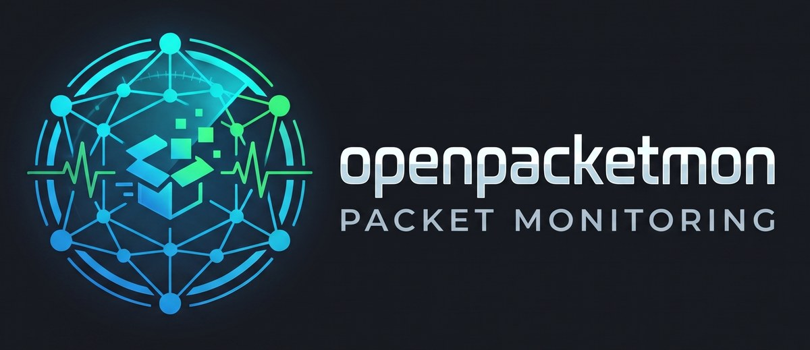

<p align="center"></p>

# openpacketmon

openpacketmon shows what your computer is talking to on the network: hosts, countries, services, programs and live traffic
charts, down to the single packet. It is a native program with its own window, in the style of
[opennetmon](https://github.com/tomCSLK/opennetmon).

> **Status: early version.** Expect rough edges, and please report what you find.

Platform: Linux on x86-64. The package is made for Ubuntu 24.04 or newer, Debian 13 or newer and systems based on
them; it needs glibc 2.39 or newer. A Windows version is being tested and follows later.

## Installation

Download the `.deb` from the [latest release](https://github.com/tomCSLK/openpacketmon/releases/latest) and install it:

```sh
sudo apt install ./openpacketmon_*.deb
```

The package also grants the capture capabilities, see [Security](#security). A new version is installed the same way;
openpacketmon shows when one is available.

## Based on Sniffnet

openpacketmon is a fork of [Sniffnet](https://github.com/GyulyVGC/sniffnet) by Giuliano Bellini and the Sniffnet contributors.
The packet capture, parsing and analysis come from Sniffnet. openpacketmon replaces the user interface and goes its own way
from here on; it is not affiliated with or endorsed by the Sniffnet project.

## Building

```sh
sudo apt install libpcap-dev libasound2-dev
cargo build --release
```

This builds two programs: `openpacketmon` (the window and the analysis, without special rights) and `openpacketmon-capture`.
Capturing needs raw socket rights. Only this small helper gets them; it gives them up as soon as the adapter is open:

```sh
sudo setcap cap_net_raw,cap_net_admin=eip target/release/openpacketmon-capture
```

To build the Debian package (with start menu entry and icons):

```sh
cargo install cargo-deb
cargo build --release --workspace   # cargo deb only builds openpacketmon itself
cargo deb
sudo apt install ./target/debian/openpacketmon_*.deb   # also sets the capture capabilities
```

`dev/build-deb.sh` does the same and stops if the version in `Cargo.toml` is not newer than the installed one, because apt
skips a package whose version is already installed, or if `THIRD-PARTY-LICENSES.txt` no longer matches `Cargo.lock`. Bump the version first (`0.x.y`: `y` for small changes, `x` for larger
steps).

## Usage

Start openpacketmon from the application menu. Choose a network adapter, a capture file or an IPFIX collector on the first
page and start the capture; overview, connections, hosts, services, programs and notifications follow it live. Closing the
window ends the program and the capture; it asks first while a capture is running. Notifications and their sounds therefore
only come while the program is open, and nothing keeps running in the background.

The *Connections* page filters with one field in the same grammar as the display filter (`port == 443 and country == US`,
`program contains firefox`, `favorite`). Hosts, programs and IP addresses can be favorites; a notification reports new traffic
of a favorite. The *Packets* page lists the single packets in one continuous list that follows the capture live (with "Go to
packet"), with a display filter (`dns`, `tls.sni contains amazon`, `ip.addr == 192.168.1.0/24`) and coloring rules; it shows
their layers (including DNS, DHCP, TLS server names, HTTP, SSDP, NTP and QUIC) and bytes, copies them with Ctrl+C or the
context menu, follows TCP and UDP streams and saves the packets as a PCAP file for Wireshark. A TCP analysis marks retransmissions, gaps, duplicate ACKs and zero windows and
measures round trip, handshake and DNS response times; the *Statistics* page shows the protocol hierarchy, these findings and
a traffic chart for any display filter. The capture page also chooses whether the packets are kept whole, as headers only
(less memory) or not at all. The packets stay in memory, up to the limits chosen in the settings (2 million packets, 2 GiB);
when a limit is reached, the oldest ones are dropped.

```sh
openpacketmon                        # open the window
openpacketmon --adapter enp0s31f6    # start capturing on this adapter right away
openpacketmon --import capture.pcap  # analyze a PCAP file right away
openpacketmon --list-adapters        # show the network adapters and exit
```

### Countries and network operators

openpacketmon ships no geolocation data. *Settings → Geolocation → Download geolocation databases from DB-IP* fetches the
free [DB-IP](https://db-ip.com) databases "IP to Country Lite" and "IP to ASN Lite" (CC BY 4.0, about 10 MB) into
`~/.local/share/openpacketmon/geo`; this is the only time openpacketmon contacts db-ip.com, and a new edition comes out
every month. Alternatively openpacketmon uses MaxMind GeoLite2 files kept up to date by `geoipupdate` in `/var/lib/GeoIP`,
or any MMDB file chosen in the settings (MaxMind, DB-IP or IPinfo format). Without a database, countries and network
operators stay empty.

### Network access of openpacketmon itself

At startup openpacketmon asks the GitHub API for the latest version; no data about your network is sent, and *Settings →
Updates* switches this off. Apart from that it only contacts the network for the download above, for reverse DNS lookups of
the addresses it sees, and for the latency measurement you start on a connection page.

### AI assistants

openpacketmon can answer AI assistants over the Model Context Protocol (MCP), for example to look into a device on your
network together with Claude Code. This is off until you turn it on in *Settings → AI assistants (MCP)*, and it only works
while the window is open. Then connect the assistant once:

```sh
claude mcp add openpacketmon -- openpacketmon mcp
```

An assistant can read the state of the capture, an overview, the connections, the packets with their protocol fields, and the
statistics, narrowed down with the same filters as in the window. It cannot change anything, and it gets no packet contents:
no bytes, no streams, and neither the query of a URL nor secrets such as cookies in HTTP headers, and its filters cannot find
them out either. A token in the path of a URL looks like any other path, so it is not hidden.

For a closer look you can also allow packet contents (*Allow packet contents* in the same card). An assistant can then follow
a stream as text or hex dump and read the bytes of a packet, which includes the content of unencrypted connections. This
switch is never saved: it ends when you close the window or turn the access off. Even then the values of secret HTTP headers
(cookies, authorization, tokens, sessions), the queries of URLs and passwords after `PASS` or `AUTH` are replaced by `x`;
secrets in other places, for example in an unknown protocol, stay visible. The sidebar shows while assistants have access,
and in amber while they can read packet contents.

**What an assistant queries goes to its AI service**: addresses, host names and connections show what your devices do. Names
and texts in a capture can come from other devices, so treat the answers with the usual care and keep the permission prompts
of your assistant on.

### Security

openpacketmon has no special rights and opens no network port, except for the access for AI assistants: when you turn that
on, the window listens on `127.0.0.1` only and answers just to a program that proves it knows the token in a file only your user can
read; the token itself never goes over the connection. Only the helper `openpacketmon-capture` may capture; it
drops its rights once the adapter is open and hands the packets on without looking into them. Packets are analyzed in the
program without rights, because their content comes from other computers. Please report vulnerabilities privately, see
[SECURITY.md](SECURITY.md).

The package lets **every user of the computer** run the helper, as Sniffnet does with its program: anyone who can log in
can capture the traffic of all adapters. On a computer you share with others, allow it only to the members of a group:

```sh
sudo groupadd --system openpacketmon
sudo usermod -aG openpacketmon "$USER"      # for each user who may capture; takes effect at the next login
sudo dpkg-statoverride --update --add root openpacketmon 0750 /usr/bin/openpacketmon-capture
sudo setcap cap_net_raw,cap_net_admin=eip /usr/bin/openpacketmon-capture   # changing the group removed the rights
```

Updates of the package keep this. After removing the package, `sudo dpkg-statoverride --remove
/usr/bin/openpacketmon-capture` deletes the setting.

## Contributing

Bug reports, tests on other distributions and small pull requests are welcome; see [CONTRIBUTING.md](CONTRIBUTING.md).
openpacketmon was largely written with the help of an AI assistant (Claude).

## License and data sources

Dual licensed under the [MIT License](LICENSE-MIT) or the [Apache License 2.0](LICENSE-APACHE), at your option,
like Sniffnet. Copyright (c) 2022 Giuliano Bellini (Sniffnet), Copyright (c) 2026 Thomas Cieslik (openpacketmon).
[NOTICE](NOTICE) lists the files of Sniffnet that were changed for openpacketmon; each of them says so at its top.

The service names (`resources/services/services.txt`) come from the IANA Service Name and Transport Protocol Port
Number Registry, which is in the public domain (CC0 1.0); `dev/update-services.py` regenerates them.
The sample databases of IPinfo used by the tests are licensed under CC BY 4.0 (see `resources/test/README.md`).
The geolocation data is not part of openpacketmon; data downloaded from DB-IP is licensed under
[CC BY 4.0](https://creativecommons.org/licenses/by/4.0/) ([IP Geolocation by DB-IP](https://db-ip.com)).
[THIRD-PARTY-LICENSES.txt](THIRD-PARTY-LICENSES.txt) lists the licenses of all crates compiled into openpacketmon and
openpacketmon-capture, of the bundled font Inter and of the data above, with the license texts; `dev/third-party-licenses.py`
regenerates it from `Cargo.lock`. The package installs it to `/usr/share/doc/openpacketmon/`, and the link *Licenses* at
the bottom of the sidebar shows it together with NOTICE.
